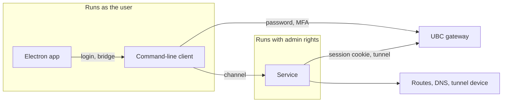

# Architecture

Status: agreed design, 2026-10-11, kept up to date as the code is built. The app, the command-line client and the service exist and talk to each other. Routes and DNS are applied on Windows; on macOS and Linux they are not yet, and connecting there fails with a reason.

## What we are building

A desktop VPN client for UBC's myVPN (a Cisco gateway that speaks the AnyConnect protocol) that does split tunnelling: only the UBC subnets the user chooses go through the VPN, and everything else stays on the normal connection. UBC's official client sends all traffic through the tunnel and cannot be configured otherwise. Sending everything through the tunnel is still available here, as an option (see "Full tunnel").

It is an open-source app with a GUI, installed from a release file, for Windows, macOS and Linux.

## Decisions at a glance

| Area | Decision |
| --- | --- |
| Routing | Transparent: once connected, every program reaches the chosen subnets with no per-program setup |
| GUI | Electron |
| Privilege | A small installed service holds the admin rights; the GUI and CLI run as the user |
| Control | Only the owner, the first user to run the app or the CLI after install, may control the service |
| Channel | Named pipe (Windows) or Unix socket (macOS, Linux), JSON messages |
| Login | Done by an unprivileged program; the service receives only a session cookie |
| CLI | A small one: `login`, `connect`, `disconnect`, `status` |
| VPN engine | `libopenconnect`, linked as a library, built by us from a pinned source tag |
| Install | System-wide on all three OSes, one admin prompt |
| Updates | Through the installer, one admin prompt each; nothing privileged updates itself |
| Signing | None for now; checksums and build attestations instead |
| Licence | `MIT OR Apache-2.0`; LGPL libraries bundled as separate, replaceable files |
| Releases | One version, one tag, one generated changelog; prepared as a pull request, published by hand |

## Components



- **Electron app.** Tray icon and window. It shows state and sends commands. It makes no security decisions, and it never opens the channel itself: it runs the command-line client and talks to that.
- **Command-line client.** Logs in and talks to the service. The GUI calls it to log in, so login exists in one place.
- **Service.** Opens the tunnel, applies routes and DNS, checks they took effect, and cleans up. It outlives the GUI, so it can always clean up.

### Connecting, step by step

1. The user presses Connect. The app asks the command-line client to log in.
2. The client reads the gateway address and certificate pin from the service's policy file, sends the username and password to that gateway only, and completes MFA.
3. The gateway returns a session cookie. The client passes it to the service over the channel.
4. The service connects with the cookie, checking the gateway against its own copy of the pin.
5. The service creates the tunnel device, pins a route to the gateway through the physical network, adds routes for the chosen subnets only, and sets DNS for the chosen domains only.
6. The service verifies the result and reports "connected". If it cannot confirm the routes are right, it reports failure and tears everything down.

## Security model

- **The service trusts only its own policy file.** The gateway's name and the certificate pins live in a file only an admin can write, and no message from the GUI or CLI can change them. A client may say which of the gateway's addresses issued its session, but the service sends nothing to that address until it presents a key matching a pin in the policy.
- **The password never reaches privileged code.** It goes from the user to the command-line client through standard input or the OS keyring, and from there only to the pinned gateway. It is never written to disk, a log, or a command line.
- **Several certificate pins are allowed.** The policy holds a list, so a planned certificate change on UBC's side does not lock users out. Pins are full-length hashes of the gateway's public key.
- **Checks fail closed.** An answer of "could not tell" counts as failure. One exception: Windows cannot show which split DNS rules its resolver took in. When our rules read back exactly and no rules from group policy exist, the check answers "cannot be observed", and the service connects and logs that split DNS could not be confirmed. Only the DNS check may give that answer; every route check must answer "yes".
- **No blind retries.** A wrong password or a pin mismatch stops at once. Retrying only wastes MFA pushes.
- **Logs are filtered.** `libopenconnect` prints the session cookie at debug level, so the service redacts its output before storing it.
- **The channel is local only.** The OS tells the service which user is calling, and the service refuses anyone but the owner. Once an owner exists, the pipe or socket permissions are narrowed to that user as well, so the OS refuses others before our code runs. The service claims its pipe or socket name exclusively and rejects remote clients.

What a rogue program running as the same user could still do: connect, disconnect, and read status. It could not redirect the tunnel or read the password.

## The channel

- **Transport:** a named pipe on Windows, a Unix socket on macOS and Linux.
- **Messages:** JSON requests and responses, plus events pushed by the service when state changes.
- **Types:** defined once in Rust. The TypeScript types are generated from them and committed; CI fails if they drift.
- **Version handshake:** the first message each way states the protocol version, so a mismatched app and service produce a clear "please update" message.

### Who opens the channel

Only our Rust code opens the pipe or socket. The command-line client does it, and the app reaches the service through the client: it starts `ubc-vpn bridge` and exchanges JSON lines with it over standard input and output.

The reason is what a safe client has to do, which the platform crate's `connect` does and a general-purpose networking library does not:

- **Check who is listening before sending anything.** While the service is stopped, another local user could create a pipe or socket with its name. The client refuses anything not owned by the system.
- **Not hand over its identity.** On Windows a pipe server can act as a client that connects without asking for identification-only access. Node's networking does not ask for it. This was tested with Node 24: a test server opened a file as the connecting user. The experiment is recorded in pull request 20.
- **Connect with the least access.** The service's pipe grants ordinary users only what a client needs. Node asks for more and is refused.

So the bridge keeps all of this in one tested place, and the app's TypeScript needs no knowledge of pipes, sockets or permissions.

The bridge forwards everything except `connect`, which carries the session cookie; the app must never hold one. It sends nothing of its own, so the app still claims ownership itself. It tells the app apart the cases the app must not retry: something other than the service is listening, or the service belongs to another user of the computer. The exact lines and the rules for every edge case are defined in `crates/core/src/bridge.rs`.

## Keeping OS-specific code small

Everything that touches the operating system sits behind one interface in one crate, with a real implementation per OS and a fake one for tests. The rest of the code does not know which OS it runs on.

OS-specific code lives in three places only: `crates/platform/`, `native/` and `packaging/`.

Route and network changes are observed through OS notifications, not polling. The previous client polled every ten seconds, mistook the tunnel's own route for the physical one, and caused connections to stall.

## VPN engine

`libopenconnect` is the only maintained open implementation of the AnyConnect protocol. We call it directly from Rust and pass it no script, so routing and DNS are done by our own code in one place.

Validated on 2026-10-11 by a throwaway test on GitHub's build machines:

| OS | Result |
| --- | --- |
| Windows | An MSVC Rust program loaded a MinGW-built library, logged in, connected, and created a Wintun adapter |
| macOS (Apple silicon) | Logged in, connected, and created a `utun` device |
| Linux | Same, including against a real `ocserv` test server |

What that test did not cover: sending traffic through the tunnel, a real UBC login, macOS on Intel, and signed builds.

Consequences we accept:

- **We build the library ourselves** on every OS, from a pinned tag. Windows has no packaged build, and Ubuntu ships a version with known bugs.
- **Many libraries are bundled.** Nine DLLs on Windows, plus Wintun.
- **Wintun support is marked experimental** by the library, with the older TAP driver as the fallback.

## GUI

TypeScript, React, Vite (through `electron-vite`), Tailwind CSS with shadcn/ui components, Motion for animation, zustand for state, pnpm for packages. Tests use Vitest and Playwright; Biome lints and formats.

The interface runs sandboxed, loads only local files, and reaches the service through a small fixed set of functions. Fonts and icons are bundled so the app looks the same everywhere.

The look is a clean dark theme, and dark is the default. Every colour, size, radius and motion value comes from one set of design tokens, and every screen is built from one shared set of components, so buttons, inputs and panels look and behave the same everywhere. A screen never styles a control by hand.

## Install, updates and releases

- **Installers:** built with `electron-builder`. A setup `.exe` on Windows, a `.pkg` on macOS, a `.deb` and `.rpm` on Linux. Each installs the app and the service together.
- **User data:** settings and the saved password stay in the user's profile and keyring.
- **Updates:** a new installer, with one admin prompt.
- **Releases:** the version and changelog are computed from commit messages with `git-cliff`. A workflow prepares the release as a branch, the maintainer opens it as a pull request, and after merging starts the publish workflow by hand. That workflow builds on three OSes with no write access, then a separate final step creates the tag, checksums, build attestations and the GitHub release. No bot credential is stored.

The release workflows are added before the first release, not now.

## Development and testing

Most work needs no admin rights.

| Layer | What runs | Admin needed |
| --- | --- | --- |
| Logic tests | The service's logic against the fake OS layer | No |
| Dev mode | The real service as a normal process with fake routing and a fake engine; the GUI connects as usual | No |
| System tests | Real routes, DNS and tunnel against a local `ocserv` | Yes; runs in CI |
| Real UBC connection | The installed app against UBC | Yes, plus the maintainer's MFA |

Dev mode is compiled out of release builds, and a test fails if a release build accepts it.

## Repository layout

```
Cargo.toml          workspace; holds the one version number
crates/
  core/             shared logic and channel message types; no OS code
  engine/           wrapper around libopenconnect, with its C helper
  platform/         the OS seam: routes, DNS, tunnel, service setup; real and fake
  service/          the privileged service program
  cli/              the command-line client
app/                Electron app
native/             pinned build recipes and patches for libopenconnect, per OS
packaging/          installer scripts and service definitions, per OS
docs/               this document and user docs
```

## Details agents need

These were settled on 2026-10-11, after the first version of this document, to remove ambiguity before development.

### Supported systems for v0.1.0

- Windows 10 and 11 on x64.
- macOS 13 or later on Apple silicon.
- Ubuntu 22.04 or later and Debian 12 or later (`.deb`), and current Fedora (`.rpm`), on x64.

Only IPv4 subnets are routed. IPv6 routes the user chooses are refused, and in split mode the system's IPv6 setup is left untouched. The one exception is full mode: the service adds the two halves `::/1` and `8000::/1` on the tunnel, to block IPv6 rather than carry it (see "Full tunnel").

### Files and where they live

| File | Holds | Written by | Readable by |
| --- | --- | --- | --- |
| `policy.json` | Gateway host name, certificate pins, optional route allow-list | The installer; admin only | Every user |
| `state.json` | The owner | The service; admin only | Admin only |
| `settings.json` | Username, chosen subnets and DNS domains, preferences | The user | The user |

All three are JSON. Only the CLI reads and writes settings, through `crates/core`; the app asks the CLI.

| | Policy | State | Settings |
| --- | --- | --- | --- |
| Windows | `%ProgramData%\UBC VPN\` | `%ProgramData%\UBC VPN\` | `%APPDATA%\UBC VPN\` |
| macOS | `/Library/Application Support/UBC VPN/` | `/Library/Application Support/UBC VPN/` | `~/Library/Application Support/UBC VPN/` |
| Linux | `/etc/ubc-vpn/` | `/var/lib/ubc-vpn/` | `$XDG_CONFIG_HOME/ubc-vpn/`, or `~/.config/ubc-vpn/` |

An update replaces `policy.json` and never touches `state.json` or `settings.json`. Uninstalling removes the policy and the state.

The settings folder belongs to the CLI. Beside `settings.json` it holds:

- `settings.json.lock`, which a command holds from reading the settings to saving them, so one change cannot undo another. Where the file system cannot give the lock, the change goes ahead without it and says so.
- `settings.json.damaged-1` to `-3`, earlier settings files that `ubc-vpn settings reset` moved aside. A reset never replaces one of them.
- `app/`, the app's own profile (Electron's data). The app keeps nothing else there and never opens `settings.json`.

On macOS and Linux the CLI creates the folder for the user alone and refuses to use one that the group or others can write to.

The app does not open `settings.json` or `policy.json` itself. It runs `ubc-vpn settings`, which reads the settings, checks routes the user typed, and saves them, so the rules for routes exist once, in `crates/core`, and are the ones the service applies when connecting. The lines exchanged are defined in `crates/core/src/settings_cli.rs`. Saved routes are used by the next connection. When the VPN is up, `set-routes` also sends the routes it has just saved to the service in an `update_routes` request, and `set-tunnel` sends the mode it has just saved in a `set_tunnel` request (see [Full tunnel](#full-tunnel)). Each reply says what came of that. The points below are for routes.
- **Checks:** the service checks the change as it checks a connect, against the policy and the network the connection was set up on. When the change adds DNS domains to a connection that has none, it also checks the DNS servers the gateway assigned. A change it refuses leaves the connection as it was.
- **No change:** a change to the routes the tunnel carries already is answered at once and does nothing. Each change is logged in one line under the repeat rule, so asking for changes again and again cannot fill the log.
- **Applying:** it adds the new routes, then sets split DNS for the new domains, then removes the dropped routes. It removes only routes it added itself, and keeps the routes to the gateway's DNS servers until the connection ends.
- **Verifying:** it checks the result, including that each dropped network no longer goes through the tunnel, unless a remaining route still holds it.
- **Failing closed:** if any step or check fails, the connection is closed and everything it applied is removed.
- **The bridge:** it refuses `update_routes` from the app, as it refuses `connect`, so a tunnel only ever carries routes from the user's saved settings.

### Which routes the service accepts

The user chooses the subnets, but the service does not apply them blindly. It refuses:

- any route wider than `/8`, which rules out a default route and the usual ways of splitting one in two. This guards against mistakes; it does not cap how much a long list of routes covers in total;
- any IPv6 route;
- any route that touches a loopback, link-local, multicast or reserved range;
- more than 256 subnets or 256 DNS domains;
- anything outside the policy's allow-list, when the policy has one;
- a route the networks the machine is directly on cover entirely between them: their routes are more specific, so the tunnel would carry none of it.

A refused route fails the connection with a clear reason. Nothing is applied partially.

Each route is checked, after it is applied, at an address it alone decides: outside every network the machine is directly on (their routes are more specific, so `10.0.0.0/8` from a home network on `10.0.0.0/24` is checked at an address outside the home network), never the gateway's, and a DNS server's only when nothing else is left.

A chosen subnet may contain the gateway itself; UBC's gateway sits inside a campus range users will want. So that traffic to the gateway never loops into its own tunnel, the service first adds a route for the one address the tunnel is connected to, through the physical network, and keeps it there for the life of the connection. It decides which network is physical when the tunnel is created and never re-derives it from a table that already contains the tunnel. When the physical network changes, the tunnel is no longer usable: the service tears everything down and reconnects from a clean state.

### Full tunnel

**Where it is available.** Full mode needs the operating system to do it and to report every IPv6 change (`NetworkEvents::reports_ipv6_changes`). Only Windows does, for now; on macOS and Linux the service refuses full mode, with the reason below.

Split tunnel is the default and the reason this client exists. A user may instead send everything through the VPN: one global setting, `global.tunnel` in the settings file, `split` or `full`, shared by every profile. The policy file may forbid full mode (`"full_tunnel": "forbidden"`); left out, it is allowed. Full mode is not a route the user chooses: the rules above for routes still apply to the user's own subnets, and full mode is modelled and checked on its own.

**What full mode does:**

- **All IPv4 traffic goes through the tunnel.** The service adds `0.0.0.0/1` and `128.0.0.0/1` through the tunnel. It never touches the default route. The halves are more specific than any default route, so they win whatever its metric, and a default route renewed by DHCP changes nothing.
- **IPv6 is blocked.** The service adds `::/1` and `8000::/1` through the tunnel, which has no IPv6 address, so every IPv6 connection that no more specific route takes elsewhere (the local network's link-local and on-link prefixes, or another interface's) fails at once, and programs fall back to IPv4. Teredo and 6to4 cannot get round this: they carry IPv6 inside IPv4, and that IPv4 follows the halves. Where the tunnel adapter has no IPv6 at all, the halves cannot be added. Full mode is then refused, before anything is changed, if there is an IPv6 leak path: a unicast IPv6 route on any interface other than the tunnel, whether that interface is up or down, other than `fe80::/10` (link-local), `::1/128` (loopback) and `ff00::/8` (multicast); Teredo's `2001::/32` counts. With no leak path it goes ahead without the IPv6 halves, since nothing can leak. That is a snapshot: while connected, the service checks again whenever an IPv6 route or address changes on any interface (`Ipv6Changed`), and fails closed if a leak path has appeared.
- **All DNS goes to UBC's DNS servers, through the tunnel.** On Windows a catch-all name-resolution rule (NRPT namespace `.`) names the tunnel's DNS servers, beside the split-DNS rules for the user's domains. It takes precedence over Windows' habit of asking every network's DNS server at once: queries go only to the tunnel's servers, over IPv4 and IPv6 alike. A single-label name is sent to UBC's servers with the local network's suffix added. The rules this product writes are volatile, so a crash or a restart cannot leave a dead `.` rule behind; the service also clears its rules when it starts.
- **The local network stays reachable directly:** every network the machine is on, on any adapter (a virtual machine program's host-only network is on an adapter of its own), and the router. Their routes are more specific than the halves. The gateway keeps its own route through the physical network, as in split mode. A network counts only through an address in use, on an interface that is up: on Windows, one whose duplicate-address check finished (preferred, or deprecated but still valid). An adapter that is not connected, such as unplugged Ethernet, Bluetooth or an idle VPN adapter, has a tentative `169.254.x.x` address with no route, so it puts the machine on no network, and that range goes through the tunnel like any other. A `169.254.x.x` address in use, such as on a cable with no DHCP, has a route and stays direct.
- **The user's own subnets and domains stay applied.** Full mode adds to them, so switching is only adding or removing the halves and the `.` rule, and routing the gateway's DNS servers when the connection had not. A route change in full mode keeps the halves and the `.` rule. When it drops every DNS domain, the split-DNS rules stay until the mode or the connection ends: clearing them on Windows takes the `.` rule with it, and names would go to the local network's resolver until it was set again. They name the same servers as the `.` rule, so nothing changes for the user.

**What it refuses**, before anything is changed, with `route_refused` and a reason the user can read. At `connect`, the policy and the OS are checked before anything is done, the network before the gateway is contacted, and the rest once the tunnel is open and before anything is applied to it. On `set_tunnel`, all of it is checked before the switch is admitted, so the connection is kept as it was:

- the policy forbids it;
- the gateway assigned no DNS server, so DNS could not go to UBC (one it assigned that cannot be used fails the connect as in split mode);
- another program already sends all traffic somewhere, such as another VPN's own `/1` halves, or already resolves all names, such as a foreign `.` rule from Tailscale's "override local DNS" or exit node;
- the router is not inside a network the physical interface is on, such as with a `/32` or point-to-point address, or a router given by DHCP option 121, so it could not be kept reachable directly;
- the tunnel has no IPv6 and there is an IPv6 leak path, as above;
- the operating system cannot do it, or cannot report IPv6 changes, which full mode must watch.

**What it cannot do**, said to the user:

- **Programs that resolve names themselves,** such as a browser using DNS over HTTPS or a program with its own resolver, are not sent to UBC's DNS servers. Their traffic still goes through the tunnel, so nothing leaks onto the local network.
- **Names only the local network knows** (`.lan`, `.home`) and captive portals do not resolve. mDNS, LLMNR and NetBIOS names still work: they never go to a DNS server.
- **More specific routes of other interfaces still win.** Examples are a second network adapter, a virtual switch for virtual machines, or Tailscale's `100.64.0.0/10`. Traffic to them goes there, not through the tunnel.

**Checks.** Every one must answer yes, or the connection fails closed:

- an address in each IPv4 half, outside the user's subnets and the local network, uses the tunnel;
- an address in each IPv6 half uses the tunnel, unless there was nothing to block as above; the IPv6 check answers yes only when every route of the longest matching prefix goes through the tunnel;
- the gateway, the router and every network the machine is on do not use the tunnel. The check is "not the tunnel", not "the physical interface": a host-only network rightly uses its own adapter;
- each DNS server uses the tunnel;
- the DNS rules read back exactly. Windows cannot show which server a query really went to, so DNS answers "cannot be observed" there, as for split DNS; issue #214 is the end-to-end test of it.

**Switching while connected** goes the way of a live route change, with `set_tunnel`, and never reconnects:

- **To full:** route the DNS servers if the connection had not, add the halves, then the `.` rule, then check.
- **To split:** remove the `.` rule, then the halves, then check that addresses outside the user's subnets no longer use the tunnel, IPv6 included, and that the `.` rule is gone.
- **Teardown** removes the halves, then the `.` rule, then the rest, as for a split connection.
- **A switch that fails its checks is undone:** switching must not break the connection. When every step of a switch worked but its checks failed, the service undoes it, removing what it added and putting back what it removed, each change recorded as for the switch. It then checks the mode it had in full, as a switch to that mode is checked: for split, the subnets and split DNS, and that the halves, the IPv6 halves and the `.` rule are gone; for full, everything full mode checks. Only when the undoing and its checks both pass does the connection stay up, in the mode it had. The channel then sends `switch_undone` with the reason (`verification_failed`), just before the state. `ubc-vpn settings set-tunnel` reports it as refused, and the app shows "Still on split tunnel" (or full) with the reason and saves the mode back. The DNS servers' routes that a switch to full added stay: a change never removes them. Split DNS for domains a route change dropped in full mode is not put back when a switch to split is undone: it was kept only because clearing it takes the `.` rule with it.
- **Failing closed:** a step of a switch that fails, or an undoing that fails or whose checks fail or cannot tell, closes the connection and removes everything, as for a route change. A connect that fails its checks is never undone this way: it fails and removes everything. So does a change detected while connected (`Ipv6Changed`, a change of the physical network).
- **What the user sees:** the VPN never drops, UBC traffic is never interrupted, and nothing leaks, but connections to non-UBC sites may reset on a switch. A connection that was open to such a site starts sending its packets another way, from another address.
- **The bridge** refuses `set_tunnel` from the app, as it refuses `update_routes`. The mode comes from the user's saved setting, which `ubc-vpn settings set-tunnel` saves and then applies.

### Who the owner is

The owner is the only user the service takes commands from.

- **Before anyone has claimed it,** the service accepts one request, `claim`, from any local user, and nothing else. The app and the CLI both send it automatically on first use, so whichever the user runs first makes them the owner.
- **Once claimed,** the service writes the owner to `state.json`, narrows the pipe or socket permissions to that user, and refuses everyone else.
- **Changing the owner** needs admin rights: an admin deletes `state.json` or runs the service's reset command.
- **Updates keep the owner,** because they do not touch `state.json`.

This works the same way on all three OSes, and does not depend on which account typed the admin password during install. The cost is a window between install and first use in which any local user could claim the service.

### How the app drives login

The app never handles the cookie, and never talks to the gateway. It runs the CLI and relays prompts:

1. The app starts `ubc-vpn connect --json`.
2. The CLI takes the username from settings and the password from the keyring when they are saved, and asks for whatever is missing. It uses the active profile, or the one `--profile <id>` names. A saved password is sent only for the username it was saved for, compared without regard to case; one saved for another username is deleted and the user is asked. A saved password is never sent twice in a row after a refusal. If the gateway rejects an attempt that used it, the CLI reports `wrong_password` and remembers that the saved password is in doubt; the next attempt asks the user to type the password. The gateway does not say which answer was wrong, so the saved password is deleted at once only when no one-time code was entered in that attempt. When a code was entered it is kept until the next attempt settles it: a typed password that then succeeds replaces it. After a successful login, once the service has accepted the connect, the CLI saves a typed password when the profile asks for that. A refused password keeps the saved username; a username the gateway refuses as a username (`check_username`) is forgotten, with its saved password. With no usable keyring the CLI says so and asks for the password each time.
3. Each question is one JSON line on the CLI's standard output: `{"type":"prompt","id":1,"kind":"password","label":"Password"}`. `kind` is `username`, `password`, `code` or `text`. A prompt may also carry a `message` with whatever the gateway says alongside the question.
4. The app answers on the CLI's standard input: `{"type":"answer","id":1,"value":"..."}`, or `{"type":"cancel"}` to stop.
5. When the gateway accepts the login, the CLI sends the service a `connect` request carrying the cookie, the address of the gateway that issued it, the chosen subnets and the chosen DNS domains, over the channel. The service uses that address only as a hint about where to connect: it refuses addresses that cannot be a gateway, and whatever answers must still match a pin in its own policy before the cookie is sent.
6. The CLI ends with one final line and exits: `{"type":"done"}`, or `{"type":"error","code":"wrong_password","message":"..."}`. Error codes include `wrong_password`, `pin_mismatch`, `cancelled`, `gateway_unreachable`, `route_refused`, `busy`, `not_owner` and `service_unavailable`.

From then on the app learns the connection state from the events the service pushes, which reach it through its bridge. `ubc-vpn login` does steps 2 to 4 only and reports whether the credentials work, without connecting.

The exact message types live in `crates/core` and are the reference; this section describes their shape.

### Wire format

Newline-delimited JSON, one message per line. The service drops a connection that sends a line longer than 64 KiB. TypeScript types are generated from the Rust types with `ts-rs`.

### The log the owner can read

The service keeps its recent log lines in memory and the owner can read them, for the app's log view and for a report to paste into a bug report. The shapes are in `crates/core/src/protocol/`: the requests in `mod.rs`, and the lines and pages in `log.rs` (protocol version 6).

- **What is kept:** 500 lines from the service and the engine, and 100 lines that the client hands over from a login, in a space of their own so a client cannot push the service's lines out. Nothing is written to disk.
- **Before a line is kept:** the service removes any character that could mislead when shown, then every secret it holds at that moment, then everything from a word such as `cookie`, `pass` or `session` to the end of the line, which it replaces with `[redacted]`. A line that is empty or too long after the first step is replaced whole by a marker, not shortened to fit. Debug-level lines are never kept. Only the exact form of a secret is found; one that is split or encoded is not.
- **The session cookie** is held for this cleaning for 30 seconds after a connection ends, or until the next one starts, and is then wiped.
- **Reading:** `logs` returns a page of lines after a given point, `watch_logs` asks for new lines as events, and `diagnostics` returns a short summary with no paths and no user names. All are for the owner only. A reader that falls behind loses log events, not its connection, and reads the gap again with `logs`.
- **What a reader may see:** login lines can name the username and what the gateway said, and lines can name local paths and addresses. The app's log view is not built yet; it will say so before it copies a report.

### When the session expires

If the service cannot resume a session, during reconnect or otherwise, it reports "login needed" and stops. The app asks the user to log in again. The service never retries a login by itself.

### DNS on Linux

Not built yet: the service refuses routes and DNS on Linux for now. The plan for v0.1.0 is systemd-resolved only. The packages declare it as a dependency, since Debian does not install it by default. The `.rpm` names `systemd-resolved`. The `.deb` names `systemd-resolved | systemd (<< 251.3-2~)`, because on Ubuntu 22.04 it is part of systemd and no separate package exists. Where it is not running, connecting fails with a message that says so.

### Licences outside Cargo

`cargo deny` covers Rust crates only. npm packages get their own licence check in CI.

Wintun, the Windows tunnel driver, ships as a prebuilt signed binary under its own licence, which is neither one of the permissive licences on our list nor LGPL. The owner has approved bundling it, on the conditions recorded in `.claude/rules/dependencies.md`. It is the one component of the Windows installer that is not open source, and packaging must leave it out of any code signing.

The app's bundled fonts are under the SIL Open Font License 1.1, approved in the same place for font files only.

The Microsoft Visual C++ runtime (`vcruntime140.dll`) ships beside the service and the command-line client, copied unmodified from the building Visual Studio's `VC\redist` folder, which Microsoft's Distributable List allows. The owner approved it on the conditions in the same file; its version and checksum are pinned in `packaging/windows/vcruntime.lock`, and Microsoft's Visual Studio Community 2026 licence terms (the maintainer's licence, under which it is redistributed) and Distributable List ship with it. Their distribution requirements are met by the setup program's licence page and by indemnifying Microsoft, as the rule records. The two programs are linked with `/DEPENDENTLOADFLAG:0xA00`, so the DLLs they import come from their own folder, the admin-only install folder, and System32, and never from the working folder or `PATH`.

### What the installers must do

A trial packaged the app with pnpm and `electron-builder` on all three OSes, installed it on CI runners, and looked at what landed where. It works. These are the rules it produced; each was observed on a runner unless it says otherwise.

**Every OS**

- The installed service and the libraries it loads run only from a folder that ordinary accounts cannot change: writable only by root on macOS and Linux, and only by SYSTEM, the Administrators group and Windows' own installer account (TrustedInstaller) on Windows. Every folder above it is owned by one of those accounts and lets no one else delete, rename or replace what is in it, so the folder cannot be swapped either; adding something new is allowed there, since users may create folders in the root of a drive. The installed service checks this when it starts and refuses to run otherwise. On Windows it also keeps those folders open while it runs, so none can be renamed (`crates/platform/src/windows/program.rs`). Dev mode, which runs unprivileged from a build folder, is exempt.
- Extra files (the command-line client, the native libraries, licence texts) ship as separate files beside the app, outside the app archive. They arrive on the user's disk byte for byte as built.
- Electron's fuses are set so that a packaged app cannot be run as plain Node, ignores `NODE_OPTIONS` and `--inspect`, and loads its code only from the app archive. No fuse covers `--remote-debugging-port`, so the main process removes the remote debugging switches itself before anything else.
- The archive's integrity is checked at start on Windows and macOS. Electron has no such check on Linux, where root-owned files are the only protection.
- No updater is included, and the build produces no update feed for one to read.
- The fonts' licence files are copied into the package explicitly; the build does not pick them up by itself.

**Windows**

- The setup program installs for the whole machine into `Program Files` and does not let the folder be changed. Given the `/D=` option it stops with a message and installs nothing; in the trial that option installed, and registered the service, in a folder ordinary users could write to.
- The data folder under `ProgramData` gets its owner and access list set by the installer on every install and update, never inherited: a folder made there by default lets users create files in it. A user can also create the folder before the first install, so on a first install the installer empties a folder it finds there, unless the administrators alone own and control it and its `state.json` names an owner: a failed update leaves such a folder, and the setup program run after it counts as a first install, so emptying it would let anyone who can make an update fail reset the owner. On an update it keeps the contents, so `state.json` survives. The service checks the folder's owner and access list when it starts, and refuses to run if they are wrong.
- The installer's script hooks run as an administrator and can register, start and remove the service. During an update the old version's removal hooks run before the new version's install hook, so the service is stopped before files are replaced.
- With no certificate nothing is signed. If signing is added later, DLLs are never included in it, so `wintun.dll` keeps WireGuard's signature.

**macOS**

- `/Applications` is writable by any user in the admin group without a password, so such a user can swap the whole app. The service and its libraries therefore do not run from inside the app. The installer's script copies them to a folder under `/Library` that only root can write, and the daemon runs from there; the exact folder is chosen with the installer work.
- That leaves two copies of the libraries: the one in the app, which the command-line client loads as the user, and the one the service loads. Both stay separate files that can be replaced, which is what the LGPL asks for.
- A `.pkg` has no uninstall. The project ships an uninstall script that stops the daemon and removes it, the copied service and libraries, the app, the policy and the state.
- Installer scripts run twice per install, so they must be safe to repeat.
- The package is built with no signing identity. Using the ad-hoc identity would re-sign, and so change, every bundled library.
- From documentation, not tested: macOS blocks an unsigned package downloaded with a browser until the user allows it in System Settings.

**Linux**

- The app lands in `/opt/UBC VPN`, owned by root. The path contains a space, so every script and unit file quotes it.
- Our install and removal scripts are added to the ones `electron-builder` supplies, not put in their place. The supplied scripts set up the sandbox helper and the AppArmor profile the sandbox needs on Ubuntu 24.04.
- Removing the `.rpm` must delete the app's own folders, which are otherwise left behind empty.
- The `.rpm` is built without the links `rpmbuild` adds under `/usr/lib/.build-id`. Every Electron app would own the same ones, so two such packages could not be installed together.

## Open points

- **macOS update prompts.** Expected to need one admin prompt like the others; to confirm when the installer is built.
- **Windows install folder owner.** On the CI runner the account that ran the installer kept full control of the install folder. On a normal machine with UAC the owner should be the Administrators group; to confirm on a real machine, or set the owner in the installer.
- **Package and command names.** The trial's package was named after the app's `package.json`; choose the final names before release.
- **Signing.** Revisit before a public release. A signed macOS build needs a setting that keeps the bundled LGPL libraries replaceable.
- **Proxy mode.** A no-admin mode that exposes a local proxy was considered and set aside in favour of transparent routing.
