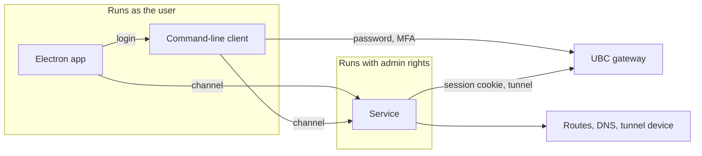

# Architecture

Status: agreed design, 2026-10-11. No application code exists yet.

## What we are building

A desktop VPN client for UBC's myVPN (a Cisco gateway that speaks the AnyConnect protocol) that does split tunnelling: only the UBC subnets the user chooses go through the VPN, and everything else stays on the normal connection. UBC's official client sends all traffic through the tunnel and cannot be configured otherwise.

It is an open-source app with a GUI, installed from a release file, for Windows, macOS and Linux.

## Decisions at a glance

| Area | Decision |
| --- | --- |
| Routing | Transparent: once connected, every program reaches the chosen subnets with no per-program setup |
| GUI | Electron |
| Privilege | A small installed service holds the admin rights; the GUI and CLI run as the user |
| Control | Only the user who installed the app may control the service |
| Channel | Named pipe (Windows) or Unix socket (macOS, Linux), JSON messages |
| Login | Done by an unprivileged program; the service receives only a session cookie |
| CLI | A small one: `login`, `connect`, `disconnect`, `status` |
| VPN engine | `libopenconnect`, linked as a library, built by us from a pinned source tag |
| Install | System-wide on all three OSes, one admin prompt |
| Updates | Through the installer, one admin prompt each; nothing privileged updates itself |
| Signing | None for now; checksums and build attestations instead |
| Licence | `MIT OR Apache-2.0`; LGPL libraries bundled as separate, replaceable files |
| Releases | One version, one tag, one generated changelog; prepared as a pull request, published by hand |

## Components



- **Electron app.** Tray icon and window. It shows state and sends commands. It makes no security decisions.
- **Command-line client.** Logs in and talks to the service. The GUI calls it to log in, so login exists in one place.
- **Service.** Opens the tunnel, applies routes and DNS, checks they took effect, and cleans up. It outlives the GUI, so it can always clean up.

### Connecting, step by step

1. The user presses Connect. The app asks the command-line client to log in.
2. The client reads the gateway address and certificate pin from the service's policy file, sends the username and password to that gateway only, and completes MFA.
3. The gateway returns a session cookie. The client passes it to the service over the channel.
4. The service connects with the cookie, checking the gateway against its own copy of the pin.
5. The service creates the tunnel device, adds routes for the chosen subnets only, and sets DNS for the chosen domains only.
6. The service verifies the result and reports "connected". If it cannot confirm the routes are right, it reports failure and tears everything down.

## Security model

- **The service trusts only its own policy file.** The gateway address and the certificate pins live in a file only an admin can write. No message from the GUI or CLI can change where the tunnel goes.
- **The password never reaches privileged code.** It goes from the user to the command-line client through standard input or the OS keyring, and from there only to the pinned gateway. It is never written to disk, a log, or a command line.
- **Several certificate pins are allowed.** The policy holds a list, so a planned certificate change on UBC's side does not lock users out. Pins are full-length hashes of the gateway's public key.
- **Checks fail closed.** An answer of "could not tell" counts as failure.
- **No blind retries.** A wrong password or a pin mismatch stops at once. Retrying only wastes MFA pushes.
- **Logs are filtered.** `libopenconnect` prints the session cookie at debug level, so the service redacts its output before storing it.
- **The channel is local only.** The OS refuses other users before our code runs, and the service re-checks who is calling. The service claims its pipe or socket name exclusively and rejects remote clients.

What a rogue program running as the same user could still do: connect, disconnect, and read status. It could not redirect the tunnel or read the password.

## The channel

- **Transport:** a named pipe on Windows, a Unix socket on macOS and Linux.
- **Messages:** JSON requests and responses, plus events pushed by the service when state changes.
- **Types:** defined once in Rust. The TypeScript types are generated from them and committed; CI fails if they drift.
- **Version handshake:** the first message each way states the protocol version, so a mismatched app and service produce a clear "please update" message.

## Keeping OS-specific code small

Everything that touches the operating system sits behind one interface in one crate, with a real implementation per OS and a fake one for tests. The rest of the code does not know which OS it runs on.

OS-specific code lives in three places only: `crates/platform/`, `native/` and `packaging/`.

Route and network changes are observed through OS notifications, not polling. The previous client polled every ten seconds, mistook the tunnel's own route for the physical one, and caused connections to stall.

## VPN engine

`libopenconnect` is the only maintained open implementation of the AnyConnect protocol. We call it directly from Rust and pass it no script, so routing and DNS are done by our own code in one place.

Validated on 2026-10-11 by a throwaway test on GitHub's build machines:

| OS | Result |
| --- | --- |
| Windows | An MSVC Rust program loaded a MinGW-built library, logged in, connected, and created a Wintun adapter |
| macOS (Apple silicon) | Logged in, connected, and created a `utun` device |
| Linux | Same, including against a real `ocserv` test server |

What that test did not cover: sending traffic through the tunnel, a real UBC login, macOS on Intel, and signed builds.

Consequences we accept:

- **We build the library ourselves** on every OS, from a pinned tag. Windows has no packaged build, and Ubuntu ships a version with known bugs.
- **Many libraries are bundled.** About twenty DLLs on Windows, plus Wintun.
- **Wintun support is marked experimental** by the library, with the older TAP driver as the fallback.

## GUI

TypeScript, React, Vite (through `electron-vite`), Tailwind CSS with shadcn/ui components, Motion for animation, zustand for state, pnpm for packages. Tests use Vitest and Playwright; Biome lints and formats.

The interface runs sandboxed, loads only local files, and reaches the service through a small fixed set of functions. Fonts and icons are bundled so the app looks the same everywhere.

## Install, updates and releases

- **Installers:** built with `electron-builder`. A setup `.exe` on Windows, a `.pkg` on macOS, a `.deb` and `.rpm` on Linux. Each installs the app and the service together.
- **User data:** settings and the saved password stay in the user's profile and keyring.
- **Updates:** a new installer, with one admin prompt.
- **Releases:** the version and changelog are computed from commit messages with `git-cliff`. A workflow prepares the release as a branch, the maintainer opens it as a pull request, and after merging starts the publish workflow by hand. That workflow builds on three OSes with no write access, then a separate final step creates the tag, checksums, build attestations and the GitHub release. No bot credential is stored.

The release workflows are added before the first release, not now.

## Development and testing

Most work needs no admin rights.

| Layer | What runs | Admin needed |
| --- | --- | --- |
| Logic tests | The service's logic against the fake OS layer | No |
| Dev mode | The real service as a normal process with fake routing and a fake engine; the GUI connects as usual | No |
| System tests | Real routes, DNS and tunnel against a local `ocserv` | Yes; runs in CI |
| Real UBC connection | The installed app against UBC | Yes, plus the maintainer's MFA |

Dev mode is compiled out of release builds, and a test fails if a release build accepts it.

## Repository layout

```
Cargo.toml          workspace; holds the one version number
crates/
  core/             shared logic and channel message types; no OS code
  engine/           wrapper around libopenconnect, with its C helper
  platform/         the OS seam: routes, DNS, tunnel, service setup; real and fake
  service/          the privileged service program
  cli/              the command-line client
app/                Electron app
native/             pinned build recipes and patches for libopenconnect, per OS
packaging/          installer scripts and service definitions, per OS
docs/               this document and user docs
```

## Open points

- **Owner at install time.** If a standard user installs with another account's admin password, the installer must still record the person at the keyboard as the owner.
- **macOS update prompts.** Expected to need one admin prompt like the others; to confirm when the installer is built.
- **pnpm with `electron-builder`.** Untested together.
- **Signing.** Revisit before a public release. A signed macOS build needs a setting that keeps the bundled LGPL libraries replaceable.
- **Proxy mode.** A no-admin mode that exposes a local proxy was considered and set aside in favour of transparent routing.
