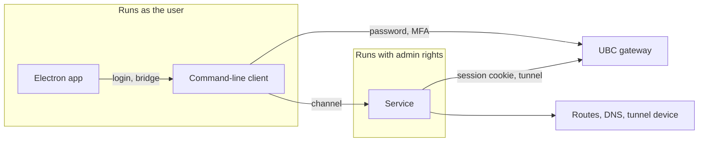

# Architecture

Status: agreed design, 2026-10-11. No application code exists yet.

## What we are building

A desktop VPN client for UBC's myVPN (a Cisco gateway that speaks the AnyConnect protocol) that does split tunnelling: only the UBC subnets the user chooses go through the VPN, and everything else stays on the normal connection. UBC's official client sends all traffic through the tunnel and cannot be configured otherwise.

It is an open-source app with a GUI, installed from a release file, for Windows, macOS and Linux.

## Decisions at a glance

| Area | Decision |
| --- | --- |
| Routing | Transparent: once connected, every program reaches the chosen subnets with no per-program setup |
| GUI | Electron |
| Privilege | A small installed service holds the admin rights; the GUI and CLI run as the user |
| Control | Only the owner, the first user to run the app or the CLI after install, may control the service |
| Channel | Named pipe (Windows) or Unix socket (macOS, Linux), JSON messages |
| Login | Done by an unprivileged program; the service receives only a session cookie |
| CLI | A small one: `login`, `connect`, `disconnect`, `status` |
| VPN engine | `libopenconnect`, linked as a library, built by us from a pinned source tag |
| Install | System-wide on all three OSes, one admin prompt |
| Updates | Through the installer, one admin prompt each; nothing privileged updates itself |
| Signing | None for now; checksums and build attestations instead |
| Licence | `MIT OR Apache-2.0`; LGPL libraries bundled as separate, replaceable files |
| Releases | One version, one tag, one generated changelog; prepared as a pull request, published by hand |

## Components



- **Electron app.** Tray icon and window. It shows state and sends commands. It makes no security decisions, and it never opens the channel itself: it runs the command-line client and talks to that.
- **Command-line client.** Logs in and talks to the service. The GUI calls it to log in, so login exists in one place.
- **Service.** Opens the tunnel, applies routes and DNS, checks they took effect, and cleans up. It outlives the GUI, so it can always clean up.

### Connecting, step by step

1. The user presses Connect. The app asks the command-line client to log in.
2. The client reads the gateway address and certificate pin from the service's policy file, sends the username and password to that gateway only, and completes MFA.
3. The gateway returns a session cookie. The client passes it to the service over the channel.
4. The service connects with the cookie, checking the gateway against its own copy of the pin.
5. The service creates the tunnel device, pins a route to the gateway through the physical network, adds routes for the chosen subnets only, and sets DNS for the chosen domains only.
6. The service verifies the result and reports "connected". If it cannot confirm the routes are right, it reports failure and tears everything down.

## Security model

- **The service trusts only its own policy file.** The gateway's name and the certificate pins live in a file only an admin can write, and no message from the GUI or CLI can change them. A client may say which of the gateway's addresses issued its session, but the service sends nothing to that address until it presents a key matching a pin in the policy.
- **The password never reaches privileged code.** It goes from the user to the command-line client through standard input or the OS keyring, and from there only to the pinned gateway. It is never written to disk, a log, or a command line.
- **Several certificate pins are allowed.** The policy holds a list, so a planned certificate change on UBC's side does not lock users out. Pins are full-length hashes of the gateway's public key.
- **Checks fail closed.** An answer of "could not tell" counts as failure.
- **No blind retries.** A wrong password or a pin mismatch stops at once. Retrying only wastes MFA pushes.
- **Logs are filtered.** `libopenconnect` prints the session cookie at debug level, so the service redacts its output before storing it.
- **The channel is local only.** The OS tells the service which user is calling, and the service refuses anyone but the owner. Once an owner exists, the pipe or socket permissions are narrowed to that user as well, so the OS refuses others before our code runs. The service claims its pipe or socket name exclusively and rejects remote clients.

What a rogue program running as the same user could still do: connect, disconnect, and read status. It could not redirect the tunnel or read the password.

## The channel

- **Transport:** a named pipe on Windows, a Unix socket on macOS and Linux.
- **Messages:** JSON requests and responses, plus events pushed by the service when state changes.
- **Types:** defined once in Rust. The TypeScript types are generated from them and committed; CI fails if they drift.
- **Version handshake:** the first message each way states the protocol version, so a mismatched app and service produce a clear "please update" message.

### Who opens the channel

Only our Rust code opens the pipe or socket. The command-line client does it, and the app reaches the service through the client: it starts `ubc-vpn bridge` and exchanges JSON lines with it over standard input and output.

The reason is what a safe client has to do, which the platform crate's `connect` does and a general-purpose networking library does not:

- **Check who is listening before sending anything.** While the service is stopped, another local user could create a pipe or socket with its name. The client refuses anything not owned by the system.
- **Not hand over its identity.** On Windows a pipe server can act as a client that connects without asking for identification-only access. Node's networking does not ask for it. This was tested with Node 24: a test server opened a file as the connecting user. The experiment is recorded in pull request 20.
- **Connect with the least access.** The service's pipe grants ordinary users only what a client needs. Node asks for more and is refused.

So the bridge keeps all of this in one tested place, and the app's TypeScript needs no knowledge of pipes, sockets or permissions.

The bridge forwards everything except `connect`, which carries the session cookie; the app must never hold one. It sends nothing of its own, so the app still claims ownership itself. It tells the app apart the cases the app must not retry: something other than the service is listening, or the service belongs to another user of the computer. The exact lines and the rules for every edge case are defined in `crates/core/src/bridge.rs`.

## Keeping OS-specific code small

Everything that touches the operating system sits behind one interface in one crate, with a real implementation per OS and a fake one for tests. The rest of the code does not know which OS it runs on.

OS-specific code lives in three places only: `crates/platform/`, `native/` and `packaging/`.

Route and network changes are observed through OS notifications, not polling. The previous client polled every ten seconds, mistook the tunnel's own route for the physical one, and caused connections to stall.

## VPN engine

`libopenconnect` is the only maintained open implementation of the AnyConnect protocol. We call it directly from Rust and pass it no script, so routing and DNS are done by our own code in one place.

Validated on 2026-10-11 by a throwaway test on GitHub's build machines:

| OS | Result |
| --- | --- |
| Windows | An MSVC Rust program loaded a MinGW-built library, logged in, connected, and created a Wintun adapter |
| macOS (Apple silicon) | Logged in, connected, and created a `utun` device |
| Linux | Same, including against a real `ocserv` test server |

What that test did not cover: sending traffic through the tunnel, a real UBC login, macOS on Intel, and signed builds.

Consequences we accept:

- **We build the library ourselves** on every OS, from a pinned tag. Windows has no packaged build, and Ubuntu ships a version with known bugs.
- **Many libraries are bundled.** About twenty DLLs on Windows, plus Wintun.
- **Wintun support is marked experimental** by the library, with the older TAP driver as the fallback.

## GUI

TypeScript, React, Vite (through `electron-vite`), Tailwind CSS with shadcn/ui components, Motion for animation, zustand for state, pnpm for packages. Tests use Vitest and Playwright; Biome lints and formats.

The interface runs sandboxed, loads only local files, and reaches the service through a small fixed set of functions. Fonts and icons are bundled so the app looks the same everywhere.

The look is a clean dark theme, and dark is the default. Every colour, size, radius and motion value comes from one set of design tokens, and every screen is built from one shared set of components, so buttons, inputs and panels look and behave the same everywhere. A screen never styles a control by hand.

## Install, updates and releases

- **Installers:** built with `electron-builder`. A setup `.exe` on Windows, a `.pkg` on macOS, a `.deb` and `.rpm` on Linux. Each installs the app and the service together.
- **User data:** settings and the saved password stay in the user's profile and keyring.
- **Updates:** a new installer, with one admin prompt.
- **Releases:** the version and changelog are computed from commit messages with `git-cliff`. A workflow prepares the release as a branch, the maintainer opens it as a pull request, and after merging starts the publish workflow by hand. That workflow builds on three OSes with no write access, then a separate final step creates the tag, checksums, build attestations and the GitHub release. No bot credential is stored.

The release workflows are added before the first release, not now.

## Development and testing

Most work needs no admin rights.

| Layer | What runs | Admin needed |
| --- | --- | --- |
| Logic tests | The service's logic against the fake OS layer | No |
| Dev mode | The real service as a normal process with fake routing and a fake engine; the GUI connects as usual | No |
| System tests | Real routes, DNS and tunnel against a local `ocserv` | Yes; runs in CI |
| Real UBC connection | The installed app against UBC | Yes, plus the maintainer's MFA |

Dev mode is compiled out of release builds, and a test fails if a release build accepts it.

## Repository layout

```
Cargo.toml          workspace; holds the one version number
crates/
  core/             shared logic and channel message types; no OS code
  engine/           wrapper around libopenconnect, with its C helper
  platform/         the OS seam: routes, DNS, tunnel, service setup; real and fake
  service/          the privileged service program
  cli/              the command-line client
app/                Electron app
native/             pinned build recipes and patches for libopenconnect, per OS
packaging/          installer scripts and service definitions, per OS
docs/               this document and user docs
```

## Details agents need

These were settled on 2026-10-11, after the first version of this document, to remove ambiguity before development.

### Supported systems for v0.1.0

- Windows 10 and 11 on x64.
- macOS 13 or later on Apple silicon.
- Ubuntu 22.04 or later and Debian 12 or later (`.deb`), and current Fedora (`.rpm`), on x64.

Only IPv4 subnets are routed. IPv6 routes are refused, and the system's IPv6 setup is left untouched.

### Files and where they live

| File | Holds | Written by | Readable by |
| --- | --- | --- | --- |
| `policy.json` | Gateway host name, certificate pins, optional route allow-list | The installer; admin only | Every user |
| `state.json` | The owner | The service; admin only | Admin only |
| `settings.json` | Username, chosen subnets and DNS domains, preferences | The user | The user |

All three are JSON. The app and the CLI read and write settings through `crates/core`, so they always agree.

| | Policy | State | Settings |
| --- | --- | --- | --- |
| Windows | `%ProgramData%\UBC VPN\` | `%ProgramData%\UBC VPN\` | `%APPDATA%\UBC VPN\` |
| macOS | `/Library/Application Support/UBC VPN/` | `/Library/Application Support/UBC VPN/` | `~/Library/Application Support/UBC VPN/` |
| Linux | `/etc/ubc-vpn/` | `/var/lib/ubc-vpn/` | `$XDG_CONFIG_HOME/ubc-vpn/`, or `~/.config/ubc-vpn/` |

An update replaces `policy.json` and never touches `state.json` or `settings.json`. Uninstalling removes the policy and the state.

### Which routes the service accepts

The user chooses the subnets, but the service does not apply them blindly. It refuses:

- any route wider than `/8`, which rules out a default route and the usual ways of splitting one in two. This guards against mistakes; it does not cap how much a long list of routes covers in total;
- any IPv6 route;
- any route that touches a loopback, link-local, multicast or reserved range;
- more than 256 subnets or 256 DNS domains;
- anything outside the policy's allow-list, when the policy has one.

A refused route fails the connection with a clear reason. Nothing is applied partially.

A chosen subnet may contain the gateway itself; UBC's gateway sits inside a campus range users will want. So that traffic to the gateway never loops into its own tunnel, the service first adds a route for the one address the tunnel is connected to, through the physical network, and keeps it there for the life of the connection. It decides which network is physical when the tunnel is created and never re-derives it from a table that already contains the tunnel. When the physical network changes, the tunnel is no longer usable: the service tears everything down and reconnects from a clean state.

### Who the owner is

The owner is the only user the service takes commands from.

- **Before anyone has claimed it,** the service accepts one request, `claim`, from any local user, and nothing else. The app and the CLI both send it automatically on first use, so whichever the user runs first makes them the owner.
- **Once claimed,** the service writes the owner to `state.json`, narrows the pipe or socket permissions to that user, and refuses everyone else.
- **Changing the owner** needs admin rights: an admin deletes `state.json` or runs the service's reset command.
- **Updates keep the owner,** because they do not touch `state.json`.

This works the same way on all three OSes, and does not depend on which account typed the admin password during install. The cost is a window between install and first use in which any local user could claim the service.

### How the app drives login

The app never handles the cookie, and never talks to the gateway. It runs the CLI and relays prompts:

1. The app starts `ubc-vpn connect --json`.
2. The CLI takes the username from settings and the password from the keyring when they are saved, and asks for whatever is missing. A saved password is never sent twice in a row after a refusal. If the gateway rejects an attempt that used it, the CLI reports `wrong_password` and remembers that the saved password is in doubt; the next attempt asks the user to type the password. The gateway does not say which answer was wrong, so the saved password is deleted at once only when no one-time code was entered in that attempt. When a code was entered it is kept until the next attempt settles it: a typed password that then succeeds replaces it. After a successful login the CLI saves the password when the settings ask for that.
3. Each question is one JSON line on the CLI's standard output: `{"type":"prompt","id":1,"kind":"password","label":"Password"}`. `kind` is `username`, `password`, `code` or `text`. A prompt may also carry a `message` with whatever the gateway says alongside the question.
4. The app answers on the CLI's standard input: `{"type":"answer","id":1,"value":"..."}`, or `{"type":"cancel"}` to stop.
5. When the gateway accepts the login, the CLI sends the service a `connect` request carrying the cookie, the address of the gateway that issued it, the chosen subnets and the chosen DNS domains, over the channel. The service uses that address only as a hint about where to connect: it refuses addresses that cannot be a gateway, and whatever answers must still match a pin in its own policy before the cookie is sent.
6. The CLI ends with one final line and exits: `{"type":"done"}`, or `{"type":"error","code":"wrong_password","message":"..."}`. Error codes include `wrong_password`, `pin_mismatch`, `cancelled`, `gateway_unreachable`, `route_refused` and `service_unavailable`.

From then on the app learns the connection state from the events the service pushes, which reach it through its bridge. `ubc-vpn login` does steps 2 to 4 only and reports whether the credentials work, without connecting.

The exact message types live in `crates/core` and are the reference; this section describes their shape.

### Wire format

Newline-delimited JSON, one message per line. The service drops a connection that sends a line longer than 64 KiB. TypeScript types are generated from the Rust types with `ts-rs`.

### When the session expires

If the service cannot resume a session, during reconnect or otherwise, it reports "login needed" and stops. The app asks the user to log in again. The service never retries a login by itself.

### DNS on Linux

v0.1.0 supports systemd-resolved only. The `.deb` and `.rpm` declare it as a dependency, since Debian does not install it by default. Where it is not running, connecting fails with a message that says so.

### Licences outside Cargo

`cargo deny` covers Rust crates only. npm packages get their own licence check in CI.

Wintun, the Windows tunnel driver, ships as a prebuilt signed binary under its own licence, which is neither one of the permissive licences on our list nor LGPL. The owner has approved bundling it, on the conditions recorded in `.claude/rules/dependencies.md`. It is the one component of the Windows installer that is not open source, and packaging must leave it out of any code signing.

The app's bundled fonts are under the SIL Open Font License 1.1, approved in the same place for font files only.

## Open points

- **macOS update prompts.** Expected to need one admin prompt like the others; to confirm when the installer is built.
- **pnpm with `electron-builder`.** Untested together.
- **Signing.** Revisit before a public release. A signed macOS build needs a setting that keeps the bundled LGPL libraries replaceable.
- **Proxy mode.** A no-admin mode that exposes a local proxy was considered and set aside in favour of transparent routing.
